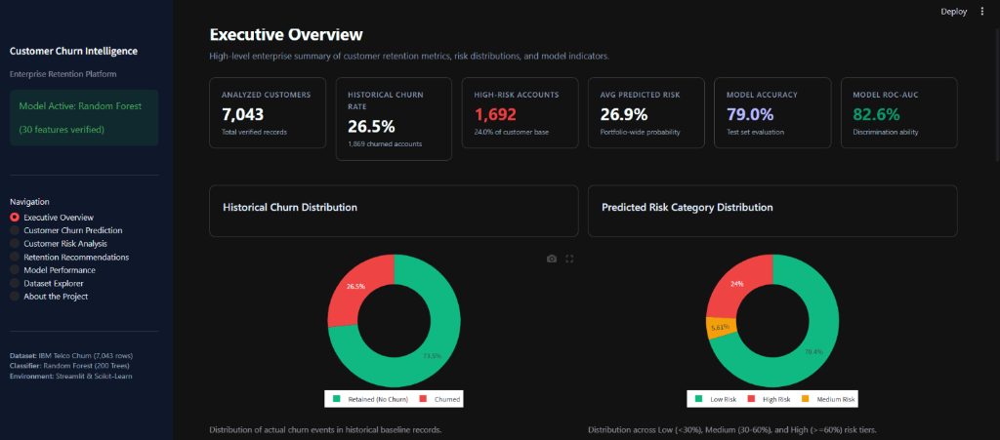
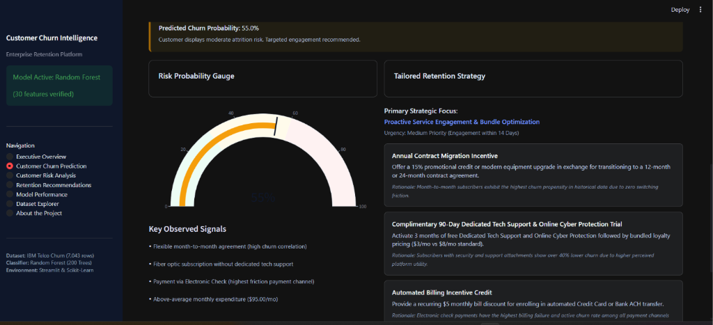
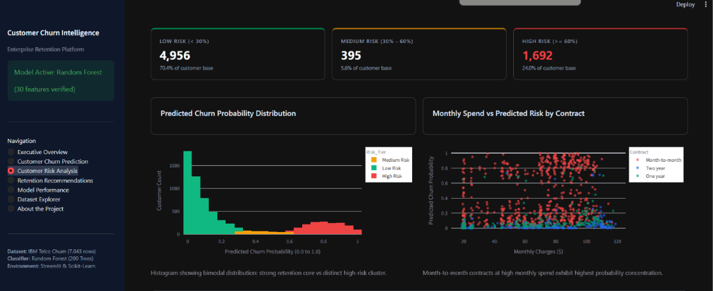
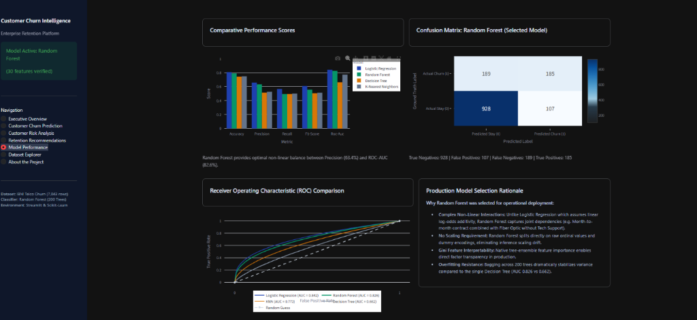

# 🎯 Customer Churn Intelligence: AI-Powered Retention Analytics

[](https://synent-task9-customerchurnprediction-avanthiga-mewlspr5hsthrhv.streamlit.app/)

[](https://www.python.org/)
[](https://synent-task9-customerchurnprediction-avanthiga-mewlspr5hsthrhv.streamlit.app/)
[](https://scikit-learn.org/)
[](https://plotly.com/)
[](https://opensource.org/licenses/MIT)

An enterprise-grade Customer Churn Prediction and Strategic Retention Platform. Built with **Streamlit**, **Scikit-Learn**, and **Plotly**, this platform transforms predictive machine learning models into an interactive, decision-support SaaS system for customer success and retention executives.

> 🌐 **Live Deployed App**: Access the interactive dashboard on Streamlit Community Cloud:  
> 🔗 **[synent-task9-customerchurnprediction-avanthiga.streamlit.app](https://synent-task9-customerchurnprediction-avanthiga-mewlspr5hsthrhv.streamlit.app/)**

---

## 📌 Project Overview

Customer attrition poses a continuous financial risk to subscription and telecom enterprises. This platform bridges the gap between raw statistical modeling and commercial execution by:
1. **Predicting Churn Propensity**: Leveraging a trained **Random Forest Classifier** across 30 dummy-encoded customer attributes.
2. **Dynamic Risk Stratification**: Segmenting subscribers into **Low Risk** (<30%), **Medium Risk** (30–60%), and **High Risk** (≥60%) tiers.
3. **Prescriptive Retention Engineering**: Delivering automated, profile-specific intervention strategies (contract conversion incentives, tech support bundles, autopay credits) tailored to each customer.
4. **Executive & Cohort Analytics**: Providing portfolio-wide revenue-at-risk analysis and segment breakdowns across contract types, tenure cohorts, and payment channels.

---

## 🏗️ Project Architecture & Structure

```text
Customer-Churn-Prediction/
├── app.py                                 # Main Streamlit enterprise multi-page application
├── requirements.txt                       # Project dependencies
├── README.md                              # Technical documentation & project guide
├── .gitignore                             # Python, cache, and notebook ignore rules
├── data/
│   └── Telco-Customer-Churn.csv           # IBM Telco customer dataset (7,043 rows)
├── model/
│   ├── churn_model_bundle.pkl             # Serialized Random Forest model & feature columns
│   └── churn_model_bundle_compressed.pkl  # Compressed deployment bundle
├── notebooks/
│   └── customer_churn_prediction.ipynb    # Comprehensive EDA, training & evaluation notebook
├── src/
│   ├── __init__.py                        # Package initializer
│   ├── prediction.py                      # Model loading, scoring & benchmark calculations
│   ├── preprocessing.py                   # Data cleaning & strict 30-feature encoder
│   └── recommendations.py                 # Intelligent retention recommendation engine
└── screenshots/                           # Dashboard previews and UI captures
```

---

## 📊 Evaluation Metrics & Model Benchmarks

Four classification algorithms were rigorously trained and evaluated on an identical **80/20 stratified split** (1,409 test samples) in the Jupyter notebook.

| Model Algorithm | Accuracy | Precision | Recall | F1-Score | ROC-AUC | Production Status |
| :--- | :---: | :---: | :---: | :---: | :---: | :---: |
| **Random Forest (200 Trees)** | **78.99%** | **63.36%** | **49.47%** | **55.56%** | **82.65%** | **Selected Production Model** |
| **Logistic Regression** | 80.70% | 65.84% | 56.68% | 60.92% | 84.16% | Evaluated Baseline |
| **K-Nearest Neighbors (k=5)** | 74.73% | 52.53% | 50.00% | 51.23% | 77.16% | Evaluated Baseline |
| **Decision Tree** | 74.17% | 51.39% | 49.47% | 50.41% | 66.23% | Evaluated Baseline |

### Production Selection Rationale
While Logistic Regression displayed marginally higher linear separability, **Random Forest** was selected for operational deployment due to:
- **Non-Linear Interactions**: Naturally captures conditional interactions between attributes (e.g. Month-to-Month contracts combined with Fiber Optic without Tech Support).
- **Inference Stability**: Operates directly on unscaled ordinal/dummy values, eliminating standard scaler drift during inference.
- **Factor Transparency**: Provides native Gini feature importance rankings to surface top churn drivers.

---

## 🖥️ Application Modules & Features

The dashboard is structured into 7 dedicated navigation pages:

1. **Executive Overview**: High-level KPI summary (total customers, historical churn rate, high-risk count, portfolio probability), churn distribution donuts, tenure curves, contract churn comparisons, and top factor weights.
2. **Customer Churn Prediction**: Real-time customer scoring form supporting manual entry and 3 pre-built demo profiles (High Risk, Low Risk, Moderate). Outputs exact churn probability, risk tier badge, risk gauge meter, and personalized retention action plans.
3. **Customer Risk Analysis**: Segmentation of the customer portfolio into Low, Medium, and High Risk tiers with interactive probability histograms, scatter spend analysis, and a filterable customer-level table with CSV export.
4. **Retention Recommendations**: Revenue exposure analytics (calculates monthly recurring revenue at risk), cohort vulnerability analysis (Month-to-month, E-check, Fiber), and an active retention priority queue.
5. **Model Performance**: Full benchmark comparison table, interactive metric comparison bar charts, confusion matrix heatmap, ROC curves, and selection rationale.
6. **Dataset Explorer**: Raw data preview with multi-select filters, column data types, missing value audit, and tenure/spend distribution charts.
7. **About the Project**: End-to-end architecture overview, technical requirements, and machine learning assumptions.

---

## Application Screenshots

### Executive Dashboard


### Customer Churn Prediction


### Customer Risk Analysis


### Model Performance


---

## 🚀 Installation & Setup

### 1. Clone the Repository
```bash
git clone https://github.com/avanthiga0630/synent-task9-Customerchurnprediction-avanthiga.git
cd synent-task9-Customerchurnprediction-avanthiga
```

### 2. Set Up a Virtual Environment
```bash
# Windows
python -m venv venv
venv\Scripts\activate

# macOS / Linux
python3 -m venv venv
source venv/bin/activate
```

### 3. Install Dependencies
```bash
pip install -r requirements.txt
```

---

## 🌐 Live Cloud Deployment

Access the deployed production application directly online without local configuration:
- 🔗 **Streamlit Cloud URL**: [https://synent-task9-customerchurnprediction-avanthiga-mewlspr5hsthrhv.streamlit.app/](https://synent-task9-customerchurnprediction-avanthiga-mewlspr5hsthrhv.streamlit.app/)

---

## ▶️ Running the Application Locally

Launch the Streamlit dashboard:

```bash
python -m streamlit run app.py
```
*(Or directly: `streamlit run app.py`)*

The enterprise dashboard will open in your browser at `http://localhost:8501`.

---

## ⚠️ Limitations & Best Practices

1. **Cross-Sectional Data**: The current model is trained on cross-sectional snapshots. In live customer operations, longitudinal time-series health scores should be ingested to track health degradation over time.
2. **Correlation vs Causation**: Feature importances and predicted risks represent historical statistical associations. Promotional interventions should be tested via A/B trials to confirm causal retention lift.
3. **Class Distribution**: Baseline churn rate in the dataset is 26.54%. ROC-AUC was prioritized to maintain a robust trade-off between False Negatives and False Positives.

---

## 📄 License
This project is licensed under the MIT License.
