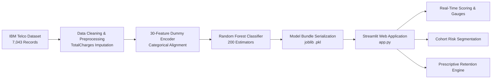

<div align="center">

# 🎯 Customer Churn Intelligence
### Enterprise AI-Powered Retention Analytics & Decision-Support Platform

[](https://synent-task9-customerchurnprediction-avanthiga-mewlspr5hsthrhv.streamlit.app/)
[](https://youtu.be/pOubbLiHEHs)
[](https://github.com/avanthiga0630/synent-task9-Customerchurnprediction-avanthiga)

<br/>

[](https://www.python.org/)
[](https://streamlit.io/)
[](https://scikit-learn.org/)
[](https://plotly.com/)
[](https://pandas.pydata.org/)
[](https://opensource.org/licenses/MIT)

<p align="center">
  <strong>An end-to-end Machine Learning SaaS solution translating predictive churn propensity into real-time prescriptive retention strategies and portfolio-level financial exposure tracking.</strong>
</p>

---

### 🌟 Quick Links

| Resource | Direct Link |
| :--- | :--- |
| 🌐 **Live Cloud Application** | **[Launch Interactive Dashboard](https://synent-task9-customerchurnprediction-avanthiga-mewlspr5hsthrhv.streamlit.app/)** |
| 🎬 **YouTube Video Walkthrough** | **[Watch Full Application Demo](https://youtu.be/pOubbLiHEHs)** |
| 📂 **GitHub Source Code** | **[Explore GitHub Repository](https://github.com/avanthiga0630/synent-task9-Customerchurnprediction-avanthiga)** |

---

</div>

## 📑 Table of Contents

- [🎬 Video Walkthrough](#-video-walkthrough)
- [📌 Project Overview](#-project-overview)
- [✨ Key Features & Modules](#-key-features--modules)
- [🖼️ Application Screenshots](#️-application-screenshots)
- [📊 Machine Learning Benchmarks & Evaluation](#-machine-learning-benchmarks--evaluation)
- [🏗️ System Architecture & Workflow](#️-system-architecture--workflow)
- [📂 Project Structure](#-project-structure)
- [🚀 Quickstart & Local Installation](#-quickstart--local-installation)
- [💡 Usage & Demo Profiles](#-usage--demo-profiles)
- [🛠️ Technology Stack](#️-technology-stack)
- [⚠️ Limitations & Future Scope](#️-limitations--future-scope)
- [📄 License & Author](#-license--author)

---

## 🎬 Video Walkthrough

Watch the complete video demonstration showcasing real-time customer scoring, interactive risk gauges, risk cohort segmentation, and prescriptive retention playbook generation:

<div align="center">
  <a href="https://youtu.be/pOubbLiHEHs" target="_blank">
    
  </a>
  <p>
    <em>👉 <strong><a href="https://youtu.be/pOubbLiHEHs" target="_blank">Click here or on the thumbnail above to play the full demo on YouTube</a></strong> (Video ID: <code>pOubbLiHEHs</code>)</em>
  </p>
</div>

### 📺 What's Covered in the Walkthrough:
1. **Executive KPI Dashboard**: Real-time portfolio metrics, churn rates, tenure breakdown, and revenue at risk.
2. **Individual Churn Prediction**: Live scoring of customer profiles using dynamic forms and instant risk gauges.
3. **Pre-Loaded Persona Testing**: Instant simulation using pre-configured High-Risk, Low-Risk, and Moderate profiles.
4. **Prescriptive Retention Playbooks**: Automated, rule-driven retention recommendations tailored to each subscriber's churn drivers.
5. **Portfolio Risk Stratification**: Cohort filtering across contract types, payment methods, and tenure bands.
6. **Model Benchmarks & XAI**: Multi-algorithm performance comparison, confusion matrices, ROC-AUC curves, and Gini feature importances.

---

## 📌 Project Overview

Customer attrition represents one of the largest silent revenue leaks in subscription, telecommunication, and SaaS business models. Replacing churned subscribers can cost up to **5× to 7× more** than retaining existing ones.

This platform bridges the critical gap between theoretical machine learning models and operational decision-making. By combining a trained **Random Forest Classifier (200 trees)** with a multi-page interactive Streamlit dashboard, business teams can:
- **Detect At-Risk Customers Early**: Calculate individual churn probability with instant risk categorization (**Low Risk**: `<30%`, **Medium Risk**: `30–60%`, **High Risk**: `≥60%`).
- **Quantify Financial Impact**: Measure Monthly Recurring Revenue (MRR) at risk across vulnerable customer cohorts.
- **Trigger Prescriptive Interventions**: Automatically generate customized retention offers (contract conversion incentives, tech support bundling, automated billing discounts).
- **Audit Model Governance**: Provide full model transparency through comparative benchmark metrics, confusion matrices, and feature importance rankings.

---

## ✨ Key Features & Modules

The platform is organized into **7 specialized navigation modules**:

| Module | Core Capabilities |
| :--- | :--- |
| **1. 📈 Executive Overview** | High-level KPI cards (Total Subscribers, Churn Rate, High-Risk Count, Portfolio Exposure), churn distribution donuts, tenure curves, contract churn comparisons, and top factor weights. |
| **2. 🎯 Customer Churn Prediction** | Real-time single-customer scoring interface. Input customer demographics, contract details, and service subscriptions manually or via **1-click demo profiles**. Displays churn probability, risk tier badge, interactive risk gauge, and personalized action plans. |
| **3. 🔍 Customer Risk Analysis** | Full-portfolio risk stratification. Interactive histograms, scatter spend analysis (Monthly Charges vs. Tenure), risk segment filters, and exportable customer-level risk tables (CSV download). |
| **4. 💡 Retention Recommendations** | Quantifies MRR at risk, analyzes high-vulnerability cohorts (Month-to-Month contracts, Electronic Check payers, Fiber Optic users), and produces prioritized retention action queues. |
| **5. 🧪 Model Performance** | Multi-algorithm benchmark matrix (Random Forest vs. Logistic Regression vs. KNN vs. Decision Tree), ROC curves, interactive confusion matrices, and operational deployment rationale. |
| **6. 📁 Dataset Explorer** | Interactive inspection of the IBM Telco dataset (7,043 customer records), with column filtering, summary statistics, missing value audit, and charge distributions. |
| **7. ℹ️ About the Project** | Architectural documentation, feature definitions, business assumptions, and machine learning pipeline mechanics. |

---

## 🖼️ Application Screenshots

### 1. Executive Analytics Dashboard
*Portfolio-wide retention health, key performance indicators, and contract-type churn distributions.*


---

### 2. Real-Time Churn Scoring & Retention Playbook
*Individual subscriber scoring with probability gauge meter and tailored retention strategy.*


---

### 3. Customer Risk Stratification & Segmentation
*Cohort-level risk decomposition across spend tiers, contract lengths, and tenure cohorts.*


---

### 4. Model Benchmarking & Governance
*Empirical comparison across 4 classification algorithms with ROC-AUC and confusion matrices.*


---

## 📊 Machine Learning Benchmarks & Evaluation

All algorithms were trained and evaluated on an identical **80/20 stratified split** (1,409 test samples) using the IBM Telco Customer Churn dataset.

| Model Algorithm | Accuracy | Precision | Recall | F1-Score | ROC-AUC | Operational Status |
| :--- | :---: | :---: | :---: | :---: | :---: | :---: |
| **🌲 Random Forest (200 Trees)** | **78.99%** | **63.36%** | **49.47%** | **55.56%** | **82.65%** | **✅ Selected Production Model** |
| **📈 Logistic Regression** | 80.70% | 65.84% | 56.68% | 60.92% | 84.16% | Evaluated Baseline |
| **🎯 K-Nearest Neighbors (k=5)** | 74.73% | 52.53% | 50.00% | 51.23% | 77.16% | Evaluated Baseline |
| **🌳 Decision Tree** | 74.17% | 51.39% | 49.47% | 50.41% | 66.23% | Evaluated Baseline |

### 🔍 Production Selection Rationale
While Logistic Regression exhibited slight marginal gains in linear separability, **Random Forest** was chosen as the primary deployment engine due to:
1. **Complex Non-Linear Interactions**: Naturally captures conditional risk factors (e.g., month-to-month contracts coupled with high fiber optic billing and absent tech support).
2. **Zero Feature Scaling Drift**: Operates directly on unscaled ordinal and binary encoded features, eliminating inference variance from scalar drift.
3. **Explainable Factor Attribution**: Provides native Gini-impurity feature importances that power the dashboard's explainable AI (XAI) risk drivers.

### 🔑 Top Churn Drivers Identified
1. **Contract Type (Month-to-Month)**: Subscribers on flexible monthly contracts exhibit significantly higher churn rates (~42.7%) compared to one-year (11.3%) and two-year (2.8%) contracts.
2. **Tenure Length**: Churn hazard is highest within the first 6–12 months of customer onboarding.
3. **Internet Service (Fiber Optic)**: Premium monthly rates without bundled tech support or online security drive customer dissatisfaction.
4. **Payment Method (Electronic Check)**: Correlates strongly with transient customer behavior versus automated credit card/bank transfer autopay.
5. **Monthly & Total Charges**: Higher relative monthly spend with low service utilization increases price sensitivity.

---

## 🏗️ System Architecture & Workflow



### End-to-End Pipeline
1. **Data Ingestion & Cleaning**: TotalCharges column sanitized, empty strings imputed to median, and binary flags normalized.
2. **Strict Feature Alignment**: Input features mapped against the frozen 30-column dummy schema used during model training to guarantee 100% schema consistency.
3. **Inference & Scoring**: Production bundle loaded via `@st.cache_resource` for sub-second scoring latency.
4. **Prescriptive Recommendation Engine**: Rules-based decision tree maps specific risk attributes (e.g. month-to-month, lack of tech support, e-check) to high-impact retention offers.

---

## 📂 Project Structure

```text
synent-task9-Customerchurnprediction-avanthiga/
│
├── app.py                                 # Main Streamlit enterprise multi-page application
├── requirements.txt                       # Production environment dependencies
├── README.md                              # Comprehensive technical documentation & project guide
├── .gitignore                             # Git ignore rules for caches, venvs, and notebooks
│
├── data/
│   └── Telco-Customer-Churn.csv           # IBM Telco Customer Churn dataset (7,043 rows)
│
├── model/
│   ├── churn_model_bundle.pkl             # Serialized Random Forest model & feature columns
│   └── churn_model_bundle_compressed.pkl  # Compressed model bundle optimized for cloud deployment
│
├── notebooks/
│   └── customer_churn_prediction.ipynb    # Full exploratory data analysis, training & evaluation
│
├── src/
│   ├── __init__.py                        # Python package initializer
│   ├── prediction.py                      # Model loading, batch inference & scoring routines
│   ├── preprocessing.py                   # Data sanitization & 30-feature encoder logic
│   └── recommendations.py                 # Prescriptive retention rules & action plans
│
└── screenshots/                           # High-resolution dashboard captures
    ├── dashboard.png                      # Executive KPI view
    ├── churn_prediction.png               # Individual scoring & gauge
    ├── risk_analysis.png                  # Portfolio risk breakdown
    └── model_performance.png              # Benchmark metrics & ROC curves
```

---

## 🚀 Quickstart & Local Installation

Follow these steps to run the application locally on your machine:

### 1. Clone the Repository
```bash
git clone https://github.com/avanthiga0630/synent-task9-Customerchurnprediction-avanthiga.git
cd synent-task9-Customerchurnprediction-avanthiga
```

### 2. Create and Activate a Virtual Environment

**On Windows (PowerShell):**
```powershell
python -m venv venv
.\venv\Scripts\Activate.ps1
```

**On macOS / Linux:**
```bash
python3 -m venv venv
source venv/bin/activate
```

### 3. Install Dependencies
```bash
pip install --upgrade pip
pip install -r requirements.txt
```

### 4. Launch the Streamlit Dashboard
```bash
streamlit run app.py
```

The application will start immediately and open in your default browser at:
```text
http://localhost:8501
```

---

## 💡 Usage & Demo Profiles

To quickly evaluate the predictive engine without manually entering 19 form fields, navigate to the **Customer Churn Prediction** page and choose from one of the pre-configured demo personas:

| Profile | Profile Characteristics | Expected Churn Propensity | Recommended Action |
| :--- | :--- | :---: | :--- |
| 🚨 **High-Risk Profile** | Month-to-Month, Fiber Optic, No Tech Support, Electronic Check, 2 Months Tenure | **> 70% (High Risk)** | Immediate contract discount, complimentary tech support bundle, and autopay enrollment incentive. |
| 🛡️ **Low-Risk Profile** | Two-Year Contract, DSL, With Tech Support & Online Security, Credit Card Autopay, 65 Months Tenure | **< 15% (Low Risk)** | Loyalty rewards, account milestone recognition, and referral upgrade promotions. |
| ⚖️ **Moderate-Risk Profile** | One-Year Contract, Fiber Optic, No Online Backup, Bank Transfer, 24 Months Tenure | **35–55% (Medium Risk)** | Mid-contract health check-in, targeted service add-on promotion, and tenure incentives. |

---

## 🛠️ Technology Stack

| Layer | Technologies | Purpose |
| :--- | :--- | :--- |
| **Core Language** | Python 3.9+ | Primary runtime environment |
| **Machine Learning** | Scikit-Learn, Joblib, NumPy | Model training, serialization, evaluation & scoring |
| **Data Processing** | Pandas | Tabular data manipulation, aggregation, and feature encoding |
| **Interactive Dashboard** | Streamlit | Enterprise multi-page SaaS web interface |
| **Data Visualization** | Plotly Express & Graph Objects, Matplotlib, Seaborn | Interactive risk gauges, cohort histograms & ROC curves |
| **Deployment** | Streamlit Community Cloud | Continuous deployment & cloud hosting |

---

## ⚠️ Limitations & Future Scope

1. **Cross-Sectional vs. Longitudinal Data**: The dataset records single-point customer snapshots. Future revisions could incorporate time-series usage trends (e.g. bandwidth drops, support tickets per month).
2. **Causal Lift Modeling**: While Random Forest accurately surfaces statistical correlations, causal inference (e.g. Uplift Modeling) can be implemented to measure the true incremental lift of promotional incentives.
3. **Threshold Optimization**: Business teams can tune the default 0.50 decision boundary based on the relative business cost of customer outreach vs. customer churn.

---

## 📄 License & Author

- **Author**: [Avanthiga Eswaramoorthy](https://github.com/avanthiga0630)
- **Demo Video**: [YouTube Walkthrough](https://youtu.be/pOubbLiHEHs)
- **Live Application**: [Streamlit Cloud](https://synent-task9-customerchurnprediction-avanthiga-mewlspr5hsthrhv.streamlit.app/)
- **Repository**: [synent-task9-Customerchurnprediction-avanthiga](https://github.com/avanthiga0630/synent-task9-Customerchurnprediction-avanthiga)
- **License**: Released under the **MIT License**. Free for educational, research, and commercial use.
